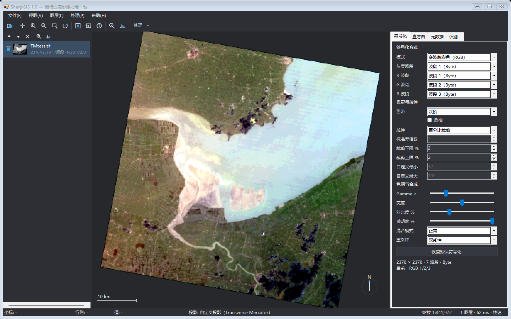

# SharpGIS

**Windows 上的栅格遥感影像处理平台** —— C# + GDAL 实现，界面与交互参考 QGIS 的栅格功能子集；
土地利用变化预测（CA-Markov + 随机森林）交给可选的 Python 引擎执行。



## 功能

### 浏览与显示
- 多图层叠加；图层栈支持显示/隐藏、上移下移、重命名、缩略图与右键菜单，多选打开
- 缩放、平移、框选缩放、1:1 像素、缩放到全图；视图历史前进/后退
- 视图旋转：三次单击（定中心 → 定手柄 → 移动预览 → 再单击提交），右下角实时指北针
- 带旋转的仿射影像自动正视化（`gdalwarp -of VRT -dstalpha`，源文件保持只读）
- 全过程不写入源目录：全局 `GDAL_PAM_ENABLED=NO`，不会产生 `.aux.xml`

### 符号化与量测
- RGB 合成 / 单波段灰度 / 色带映射，色带可选并可反相
- 拉伸：最小-最大、百分比裁剪、标准差；Gamma、亮度、对比度、透明度
- 混合模式：正常 / 正片叠底 / 滤色；重采样：最近邻 / 双线性 / 立方
- 直方图面板（端点可拖动）、元数据面板、像素识别（含 alpha 波段）
- 比例尺、鼠标处地理坐标 / 行列号 / 像素值状态栏

### 处理工具箱
| 功能 | 说明 |
|---|---|
| 格式转换 / 导出 | GeoTIFF、Erdas IMG、PNG、JPEG、BMP、ASCII 网格；GTiff 支持 LZW/DEFLATE/JPEG/PACKBITS、TILED、BigTIFF、顺带建金字塔 |
| 重投影 / 重采样 | `gdalwarp`：目标 CRS、分辨率（X/Y 可不同）、按行列数、按参考图层对齐、波段子集、导出当前视图 |
| 按范围裁剪 | 手工输入范围或用当前视图范围 |
| 生成金字塔 | 两阶段进度，失败自动清理半成品 |
| 波段计算器 | 表达式解析器 + 18 个函数面板（悬浮提示用法）+ 常用模板；跨文件波段映射，按槽位号 `b1..bN` 绑定任意同网格图层，网格不一致会被拦截 |
| DEM 派生 | 山体阴影 / 坡度 / 坡向 / 彩色渲染（`wrapper_GDALDEMProcessing`） |
| 滤波 | 均值、中值、高斯、拉普拉斯锐化、Sobel（分块 + 光晕，不整幅载入） |
| 增强 | 线性拉伸到 8bit、直方图均衡到 8bit |
| 影像融合 | Brovey / IHS / HPF（全色以自身的网格为准） |
| 非监督分类 | KMeans，可选输出调色板 |
| 土地利用变化预测 | CA-Markov + 随机森林适宜性，见下文 |

### 工程特性
- **中英双语**：中文文案即翻译键，运行时可切换（需重启）
- **可取消**：GDAL 回调与自写分块算子都会响应取消，并清理半成品
- **零测试框架依赖的自检**：`--selftest` 逐项断言并输出截图，退出码即结论

## 环境要求

| 项目 | 要求 |
|---|---|
| 操作系统 | Windows 10/11 x64（WinForms + GDAL 原生库，仅 Windows） |
| 运行时 | .NET Framework 4.8 |
| 构建 | .NET SDK 6.0 及以上（实测 10.0.401） |
| 可选 | Python 3.8+（仅 CA-Markov 功能需要） |

## 构建与运行

```bash
dotnet build SharpGIS.csproj
bin\Debug\net48\SharpGIS.exe
```

- 请**显式指定 csproj**：`dotnet build` 不带参数时可能走 `SharpGIS.slnx`，输出到另一套目录。
- GDAL 3.12.1 由 NuGet 还原；`SharpGIS.csproj` 中的 `CopyGdalRuntime` 目标只把 **x64** 原生库与
  `data/`、`share/` 复制到 `bin\Debug\net48\gdal\`，根目录不会平铺 DLL。
- 程序必须在输出目录下运行——`GdalBootstrap` 按 `AppContext.BaseDirectory` 查找原生库。

## 自检（等价于测试套件）

仓库**不包含测试影像**。准备一个目录，放入 `TMtest.tif`（约 2378×2378、7 波段 + alpha）、
`multi.tif`（400×400、3 波段）、`pan.tif`（单波段），然后：

```bash
set SHARPGIS_TESTDATA=D:\path\to\testdata

bin\Debug\net48\SharpGIS.exe --selftest
bin\Debug\net48\SharpGIS.exe --selftest --step=ui --out=artifacts\ui
bin\Debug\net48\SharpGIS.exe --selftest --step=lang --lang=en
```

| 参数 | 作用 |
|---|---|
| `--step=open\|render\|process\|camarkov\|ui\|audit\|lang` | 只跑某一步，缺省 `all` |
| `--data=<dir>` | 测试数据目录（优先于 `SHARPGIS_TESTDATA`） |
| `--out=<dir>` | 产物目录，默认 `bin\...\artifacts\selftest\<时间戳>` |
| `--lang=en` | 强制英文界面跑一遍 |

- 退出码：`0` 全部通过，`1` 有失败项，`2` GDAL 不可用。
- `--step=audit` 会逐对话框检查控件越界、文本截断、同级重叠、标签页被挤出等问题，并截图；
  截图写在 `--out` 目录下，可直接目视核对。
- `--step=lang` 会全量校验译文表无中文残留、无中文标点，并抽检反查映射。
- `bin\Debug\net48\SharpGIS.exe --probe` 把当前 GDAL C# 绑定的真实签名反射输出到
  `artifacts\api_probe.log`；升级 GDAL 前先看它，绑定命名与上游文档并不一致。

## CA-Markov 子系统（可选）

算法全部在 `Engine/camarkov_engine.py`（约 1.8k 行），C# 只负责界面、参数 JSON、进程调度与结果解析。

```bash
python -m pip install -r Engine/requirements.txt
```

解释器定位顺序：界面上次选定 → 环境变量 `SHARPGIS_PYTHON` → conda/系统常见路径 → `PATH`；
要求 numpy / scipy / scikit-learn / rasterio / matplotlib 均可导入。

引擎三种模式：`analyze`（转移矩阵 + 面积）、`train`（按类别对导出随机森林）、
`predict`（转移预算 → 适宜性 → 邻域约束 → CA 分配 → 多步外推 → 精度评价 → 栅格/报告/图）。

```bash
python Engine/camarkov_engine.py --selftest          # 纯函数自检
python tools/test_engine_lang.py                     # 中英双模式回归（合成数据）
```

进度通过 `python -u engine.py --job job.json` 的 stdout 行协议
（`@@PROGRESS / @@INFO / @@WARN / @@DONE`）回传；取消时用 `taskkill /T /F` 连带清理子进程。

## 目录结构

```
Engine/       CA-Markov Python 引擎与英文译文（随程序输出，不参与编译）
Models/       图层栈、视口、样式、统计、波段映射值对象
Rendering/    瓦片读取、拉伸、合成（含旋转双线性重采样）
Processing/   算子：导出、warp、金字塔、波段计算、DEM、滤波、增强、融合、KMeans、CA-Markov 封装
Services/     后台任务与进度、Python 定位/调用、语言表、最近文件
UI/           主窗体、地图画布、面板（符号化/直方图/元数据/识别）、对话框、自绘主题
SelfTest/     命令行自检与截图
tools/        开发脚本（不参与构建、不随程序分发）
```

## 设计要点

- **线程模型**：唯一后台入口是 `Services/JobRunner.cs`。对话框在 UI 线程由 `CaptureParameters()`
  把控件值快照成普通字段，`RunCore` 在后台线程只吃快照、绝不碰控件——否则调试时抛
  “线程间操作无效”，Release 下则静默读到不可靠值。
- **i18n**：中文原文即键，取不到译文原样返回中文，因此漏翻只显示中文而不会空白。语言必须在任何
  界面类型初始化之前确定，所以**不能在静态字段初始化器里调用 `Lang.T`**（会被固化）。
- **输出安全**：目标文件若已作为图层打开，Windows 下无法覆盖；执行前用
  `ProcessingUtil.IsFileWritable` 探测并建议新文件名，GDAL 的 `Permission denied` 会被翻译成可操作提示。
- **统计不落盘**：统计走抽样读取而非 `GDAL GetStatistics`，避免在源目录产生 PAM 旁文件。
- **调色板影像强制最近邻**：双线性会让 GDAL 警告并回退。

## 已知限制

- 不含矢量功能（点线面、属性表、符号系统均未实现），目标只是栅格影像处理。
- 仅 Windows；`.NET Framework 4.8` 与 x64 固定。
- CA-Markov 需要外部 Python 环境，仓库不捆绑解释器与依赖。

## 第三方组件与许可

本仓库**只发布源码**，不包含 GDAL 二进制或任何测试数据（`bin/`、`testdata/` 已被忽略），
首次构建时由 NuGet 还原：

| 组件 | 用途 | 许可 |
|---|---|---|
| [GDAL](https://gdal.org/) 3.12.1 + `GDAL` / `GDAL.Native` NuGet 包 | 栅格 I/O 与算法 | MIT / X11 |
| [PROJ](https://proj.org/) 9（随 GDAL.Native 分发） | 坐标系转换 | MIT |
| [GEOS](https://trac.osgeo.org/geos/)（随 GDAL.Native 分发） | 几何运算 | LGPL-2.1 |
| numpy / scipy / scikit-learn / rasterio / matplotlib | CA-Markov 引擎（用户自行安装） | BSD-3-Clause / PSF |

- GDAL 原生包还原后自带许可文件：`bin\Debug\net48\gdal\license.txt`、
  `GDALLicense.rtf`、`GISInternalsLicense.rtf`。
- 若要**分发编译好的程序**，需自行履行上述组件的许可义务，尤其是 LGPL-2.1 的 GEOS：
  保持动态链接、随包提供许可文本并说明如何替换该库。
- README 截图中的影像为 Landsat 数据（USGS 公有领域），仅作界面展示；仓库不附带该数据。

## 许可证

[MIT](LICENSE)。

## 相关文档

- [`AGENTS.md`](AGENTS.md)：给 AI 助手与新贡献者的工程约定与踩坑清单
- [`tools/README.md`](tools/README.md)：开发脚本与双语维护规则
